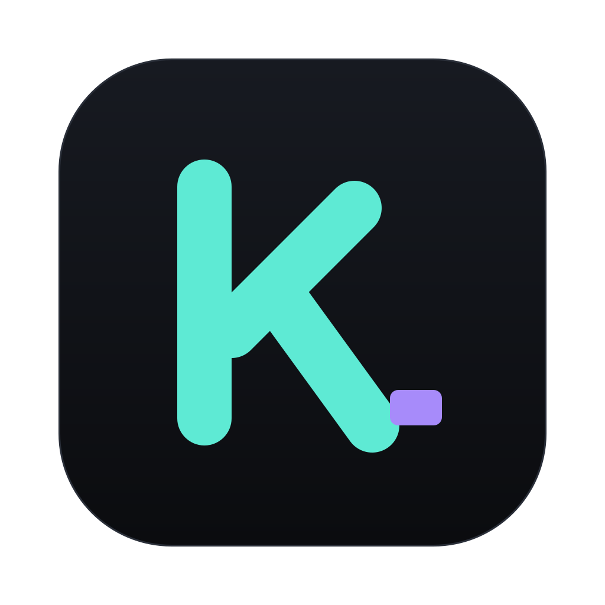

<p align="center">
  
</p>

<h1 align="center">kuaky</h1>

<p align="center">A light, native desktop editor for working with coding agents.</p>

<p align="center">
  <a href="https://github.com/Antony-potato/kuaky/releases/latest"><strong>Download</strong></a> ·
  <a href="#install">Install</a> ·
  <a href="./CONTRIBUTING.md">Contributing</a> ·
  <a href="./docs/">Design notes</a>
</p>

kuaky puts your coding agents, your code and your git work in one window. It is written in Rust with [GPUI](https://github.com/zed-industries/zed) and [GPUI Kit](https://gpui-kit.com/), so it starts fast and stays light.

It works with Claude Code, Codex, Gemini CLI, OpenCode and Antigravity. If an agent is installed and signed in on your computer, kuaky can drive it.

## What you get

- **Your subscriptions.** kuaky does not sell tokens or ask for API keys. It runs the agents you are already signed in to.
- **Usage at a glance.** Home shows the tokens and the equivalent API cost of all your agents and projects, next to your plan limits.
- **A real chat with every agent.** Plans, tool calls, permission buttons, and a diff for each edit that you can keep or reject.
- **Agents that work together.** An agent can open a session in another agent and hand it part of the work.
- **A map of your work.** Sessions are grouped into lines by goal, with live status: working, needs you, done.
- **Git built in.** A worktree per session, diffs between branches, and pull requests you can review, merge, or start a session from.
- **An editor when you need it.** File tree, syntax highlighting, project search, terminals, and language servers for diagnostics, completion and go to definition.
- **Diagrams and preview.** Agents can draw a diagram to explain something, or show your running app in a tab.
- **Open.** The source code is [GPL-3.0](./LICENSE). See [License](#license).

## Install

Download the latest version from [Releases](https://github.com/Antony-potato/kuaky/releases/latest):

| Platform              | File                                 |
| --------------------- | ------------------------------------ |
| macOS (Apple Silicon) | `kuaky-X.Y.Z-macos-arm64.zip`        |
| Windows (x64)         | `kuaky-X.Y.Z-windows-x64-setup.exe`  |

After that, kuaky updates itself: when a new version is out, an **Update** button shows up in the title bar.

> [!NOTE]
> The builds are not signed yet.
> - **Windows:** if you see "Windows protected your PC", click **More info → Run anyway**. The installer does not need admin rights.
> - **macOS:** move `kuaky.app` to Applications, then run `xattr -dr com.apple.quarantine /Applications/kuaky.app` once.

### Sign in to an agent

kuaky needs at least one agent installed and signed in, such as [Claude Code](https://claude.com/product/claude-code) or [Codex CLI](https://developers.openai.com/codex/cli). Open **Settings → Agents** to install the ones you are missing.

### Build from source

```bash
cargo run                  # open kuaky
cargo test --workspace     # run the tests
script/bundle-macos.sh     # macOS: build target/release/bundle/kuaky.app
```

## Contributing

Small, focused fixes are the most likely to be merged. For a bigger change, open an issue first so we can agree on it.

- Read [CONTRIBUTING.md](./CONTRIBUTING.md) before you open a pull request. You sign the [CLA](./CLA.md) once, on your first PR.
- Found a security problem? Do not open an issue: see [SECURITY.md](./SECURITY.md).
- The [design notes](./docs/) (in Spanish) explain the stack and the plan.

## License

kuaky is free software: you can use, change and share it under the [GNU General Public License v3.0 or later](./LICENSE). Code from other projects is listed in [THIRD_PARTY.md](./THIRD_PARTY.md).

## Trademarks and forks

The GPL applies **only to the source code**. It does not give any rights to the **kuaky** name, logo or application icon.

If you fork or redistribute kuaky:

- **Use your own name and icon** in any public fork, build, website or app listing.
- **Make it clear that your project is unofficial** and not affiliated with or endorsed by kuaky.

© 2026 Antonio Cortazar Jimenez
